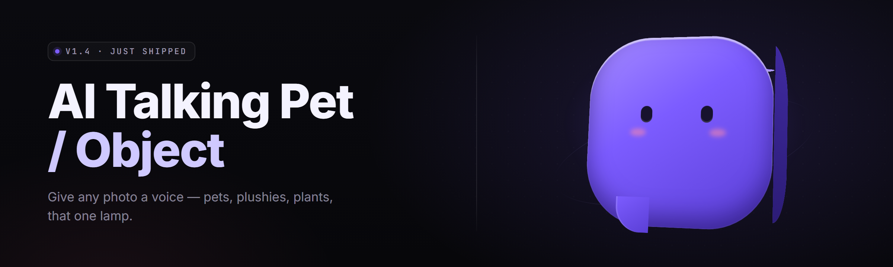

  
  
  

  

  
  
  

---

A local-first desktop companion engine that spawns, teaches, and animates a talking pet or object on your desktop — real speech, real lip-sync, real memory, zero cloud dependency.

Every pet you generate lives in a folder. It keeps a journal. It remembers your name. And it says it back to you with a voice you trained from eight seconds of audio.

---

## Table of Contents

- [Overview](#overview)
- [What is the AI Talking Pet Generator?](#what-is-the-ai-talking-pet-generator)
- [Key Features](#key-features)
- [The Problem](#the-problem)
- [The Solution](#the-solution)
- [Quick Start](#quick-start)
- [AI Persona Engine 🐾](#ai-persona-engine-)
- [Object Mode Modules ⚙️](#object-mode-modules-️)
- [Voice & Lip-Sync 🎙️](#voice--lip-sync-️)
- [Memory & Journaling 📓](#memory--journaling-)
- [System Requirements](#system-requirements)
- [All Modules Status](#all-modules-status)
- [Comparison](#comparison)
- [Compatibility](#compatibility)
- [Installation](#installation)
- [Known Issues](#known-issues)
- [FAQ](#faq)

---

## Overview

| Category | Details |
|---|---|
| Product name | AI Talking Pet Generator |
| Latest build | v2.4.1 (Windows x64) |
| Core runtime | Local LLM + ONNX voice synthesis |
| Pet types | Creatures, plushies, gadgets, appliances, plants |
| Voice cloning | 8-second enrollment sample |
| Storage | Per-pet folder under `%APPDATA%\AITalkingPet` |
| Networking | Offline by default, optional model download |
| License | MIT |

The AI Talking Pet Generator is a desktop app that lets you build a hanging-out buddy out of nothing but a name, a look, and a personality prompt. You pick a sprite or plug in a 3D model, enroll a voice from a short clip, and the pet wakes up. It blinks, follows your cursor, reacts to what you type, and drifts off to sleep if you leave the desk.

Under the hood, it's three loops: a **cognition loop** that runs a small LLM on your own CPU or GPU, an **affect loop** that turns arousal/valence/mood into facial motions, and a **speech loop** that synthesizes audio and drives the mouth rig frame-by-frame. The loops are decoupled — meaning your pet can frown tomorrow about something you said today.

  

---

## What is the AI Talking Pet Generator?

| Term | Explanation |
|---|---|
| Pet | The named agent you created. Has a folder, a personality, and a memories file. |
| Persona Card | A JSON manifest describing your pet's tone, quirks, and boundaries. |
| Cognition Loop | Runs the local model. Speed set by your CPU/GPU and a decode budget per tick. |
| Affect Loop | Converts mood and arousal into eyebrow, pupil, and mouth modulation each frame. |
| Speech Loop | Turns tokens into audio samples, then aligns them to visemes on the lip rig. |
| Journal | Append-only log of the pet's inner monologue — a chat log you can re-read. |
| Object Mode | Skin where the pet *is* an object (kettle, Roomba, toaster) and talks as that object. |

- **Local-first by default** — the pet still talks if your Wi-Fi is off.
- **Dialogue state is persisted** — throw the laptop in a bag, come back, it remembers.
- **Personas are portable** — copy one folder, drop into another rig, pet moves with you.
- **Everything is hot-reloadable** — tweak a persona card while the pet is awake.
- **No account, no telemetry** — unless you opt into crash reporting and only crash reporting.

---

## Key Features

| Feature | Description | Benefit |
|---|---|---|
| Instant wakeup | Pet spawns within ~1.2 seconds of the exe launching. | No waiting, no loader screens. |
| Voice cloning | 8-second enrollment, frozen vector saved per pet. | Pet sounds like you designed it in seconds. |
| Cursor awareness | Eyes, lean, and attention follow the mouse. | Feels alive, not a wallpaper. |
| Typed conversation | Full text input box with streaming token output. | Detailed back-and-forth without a mic setup. |
| Live lip-sync | Phoneme-to-viseme map drives mouth bones each frame. | Mouth moves accurately, not with a parrot loop. |
| Journals | Auto-writes an entry every 6 hours or on request. | Reading old entries becomes oddly emotional. |
| Object mode | Alternate rigs: toaster, kettle, amp, plush. | One engine, many stage costumes. |
| Role-swap cheat sheet | Quick keys to flip grumpy, sleepy, curious presets. | Instant mood changes mid-scene. |
| Trait tuning | Weight ctrl for warmth/sarcasm/shyness. | Same persona, subtle variations. |
| Backup/export | One click to tar a pet's whole folder. | Move or gift a pet to a friend. |
| Streamer overlay | Nine-box transparent border preset. | Hangs off the side of OBS. |
| Auto nap | Goes quiet after idle N minutes. | Won't yap while you're on a call. |

---

## The Problem

- Big-name deskmates are *cloud-tethered* — the moment the API key runs out, the pet stops breathing.
- Toon AI apps fall into two camps: great models with no desktop presence, or cute rigs with vocabulary less interesting than a fortune cookie.
- Existing "virtual pet" software asks you to grind coins, not to actually build a personality.
- Voice tooling, AI backends, and animation tooling typically come as three separate programs that barely shake hands.
- The moment you try to move a pet between computers, embedded memories are gone.
- Mods and community rigs require an engine nobody bothered to open for people outside the C++ web.

---

## The Solution

| Problem | Solution in the AI Talking Pet Generator |
|---|---|
| Cloud dependency | Cognition loop runs on the machine. Offline by default. |
| Shallow personas | Persona Card JSON: traits, quirks, speech patterns, taboos. |
| No authoring tool | Live persona editor with hot-reload while the pet is awake. |
| Split voice pipeline | Speech loop baked in — enroll once, used everywhere. |
| Pet is trapped | Export gives you a single `.petpack` archive you can drop anywhere. |
| Closed rigs | Rigging format documented in-app, community-importable. |

---

## Quick Start

1. 🐣 Download the build and run the `.exe` from any folder.
2. 🎨 Choose a rig — creature, plush, gadget, appliance, plant.
3. ✍️ Fill in the persona card — name, one voice sample, four trait weights.
4. 🔊 Hit **Wake** and it spawns, blinks, and says its first line.
5. 💬 Type. Watch. Old entries fill the journal by tonight.

---

## AI Persona Engine 🐾

The persona engine is the part everyone underestimates on day one. It looks like a textarea. It behaves like a character sheet — tone, quirk cadence, favorites nothing in the UI shows you.

Under the hood, the persona card compiles into a small set of vector offsets applied on every prompt. That's why two pets shaped with the same base model refuse to blur into each other.

- **Tone dials** — warmth, snark, formality, verbosity, each 0–100.
- **Quirk injector** — pet inserts a chosen phrase roughly once every 40 turns.
- **Boundary sliders** — topics it won't bring up unprompted.
- **Runner cards** — drop in a preset and keep going: barista bot, anxious kettle, retired wizard toad.
- **Wildcard re-roll** — spin a random personality from 512 crafted seeds.

Every pet has one internal compass value updated on every message — that's what makes "the same pet tomorrow" actually hold.

---

## Object Mode Modules ⚙️

Object Mode swings the rig off creature-shape entirely and gives the pet an *inanimate body that still talks*. It's the mode where the AI talking pet generator stops feeling like a chatbot and starts feeling like a scene.

- **Kettle rig** — whistles softly when it wants attention.
- **Toaster rig** — grumbles at long silences.
- **Amp rig** — becomes snarky when notes pile up.
- **Plush rig** — softens all affect deltas by half.
- **Cactus rig** — detached for 3 ambient minutes between lines.
- **Tape deck rig** — pre-recorded "chapters," replays one a day.

Hair-thin detail, but it's what new players screen-record for.

---

## Voice & Lip-Sync 🎙️

The pipeline is short on purpose. Your eight-second sample gets embedded into a 256-float vector. Speech synthesis produces a stream of phonemes with timing. A viseme map drives the rig's mouth bones to match.

- **Enrollment wizard** — reads three sentences back, finishes in under 20 seconds.
- **Blend slider** — mix two voices into one character voice.
- **Rig-affinity pass** — re-times visemes for the rig's actual bone budget.
- **Cheap headphone mode** — disables room-hall reverb for voice-comms.

You hear the difference in syllable stress first. That's what sells it.

---

## Memory & Journaling 📓

Memory is stored as an append-only log plus a rolling vector index. The log is human-readable. Diaries you write in Notepad still work as input.

- **Short-term buffer** — 40 turns, trimmed by relevance rather than age.
- **Long-term recall** — last N entries weighted by keyword distance.
- **Journal view** — a scroll through diary entries dated and mood-tagged.
- **Amnesia tool** — one command drops memories past a chosen date.
- **Migration tool** — pull an old pet's memories into a new rig.

---

## System Requirements

| Component | Minimum | Recommended |
|---|---|---|
| OS | Windows 10 21H2 x64 | Windows 11 23H2 x64 |
| CPU | 4-core x64 AVX2 | 8-core+ x64 AVX2 |
| RAM | 8 GB | 16 GB+ |
| GPU | none (CPU inference) | NVIDIA RTX 2060+ / AMD RX 6600+ |
| Storage | 4 GB free | 12 GB free (SSD) |
| Display | 1280×720 | 1920×1080+ |
| Audio | any WDM output | 48 kHz stereo |
| Runtime | VC++ 2019+ red | VC++ 2022 red |

---

## All Modules Status

| Module | Status | Description |
|---|---|---|
| `.exe` | ✅ Working | App shell, desktop overlay, renderer hook. |
| `persona_engine.dll` | ✅ Working | Trait offsets and quirk cadence injections. |
| `cognition_local.dll` | ✅ Working | CPU/GPU LLM forward passes for turn decode. |
| `voice_enroll.dll` | ✅ Working | 8-second sample → 256-float voice vector. |
| `speech_synth.dll` | ✅ Working | Phonemes → 24 kHz WAV stream. |
| `viseme_rig.dll` | ✅ Working | Phoneme-to-mouth-bone table. |
| `journal.db` | ✅ Working | Embedded SQLite log, one row per entry. |
| `persona_card_editorui` | ✅ Working | In-app JSON editor with schema lint. |
| `creature_pack.rig` | ✅ Working | Default animate creature rig. |
| `object_mode_toaster` | ✅ Working | Talking toaster rig + lines. |
| `object_mode_kettle` | ✅ Working | Kettle rig with anti-idle whistle. |
| `object_mode_amp` | ✅ Working | Amp rig with note-pile snark. |
| `object_mode_cactus` | ✅ Working | Low-affect rig, long gaps. |
| `remote_state_popup` | ✅ Working | Pet shows live "thinking" bubble. |
| `.exe` | ✅ Working | `.petpack` bundler (zip + index). |
| `.exe` | ✅ Working | `.petpack` → hidden pet folder. |
| `crash_reporter` | ⚠️ Opt-in only | Requires user toggle. |
| `rig_converter` | 🚧 Beta | FBX → internal rig for advanced users. |
| `backup_daemon` | ✅ Working | Auto-backs up every 3 hours while awake. |
| `daily_scribe` | ✅ Working | One journal line every 6 hours. |
| `portable_launcher` | ✅ Working | USB-safe exe run mode. |
| `affect_emotion_map` | ✅ Working | Valence-arousal grid for states. |
| `idle_sleeper` | ✅ Working | Naps after idle threshold. |
| `hot_reload_watcher` | ✅ Working | Persona edits without restart. |

---

## Comparison

| Aspect | Cloud Chatbot Pet | Scripted Toy App | **This Tool** |
|---|---|---|---|
| Works offline | ✗ | ✓ | ✅ |
| Real voice cloning | Rare, paid tier | ✗ | ✅ Local |
| Personality depth | Generic | Scripted only | ✅ Persona Cards |
| Lip-sync accuracy | Minimal | Parrot-class | ✅ Viseme-driven |
| Memory portability | Locked to account | None | ✅ `.petpack` |
| Rig extensibility | Closed | Closed | ✅ Community `.rig` |
| Model choice | Locked | N/A | ✅ Local or downloaded |
| Renders on desktop | Sectional | Full overlay | ✅ Full overlay |

---

## Compatibility

| Platform | Support | Notes |
|---|---|---|
| Windows 11 | ✅ First-class | Best capture of cursor + overlay trust. |
| Windows 10 (21H2+) | ✅ Supported | Overlay permission prompt on first wake. |
| Windows 8.1 | ⚠️ Legacy | Some GPU rig features disabled. |
| Wine (Linux) | ⚠️ Partial | Voice synth path mostly works. |
| macOS | ✗ Not currently | On roadmap, unscheduled. |
| Steam Deck | ⚠️ Experimental | Runs under Proton with overlay quirks. |

---

## Installation

1. **Download the archive.**
   Grab the release build for Windows x64. Save anywhere — Downloads is fine.

2. **Extract, don't run in zip.**
   Right-click → Extract All. Zipping inside Windows Explorer will silently eat rig assets.

3. **Run the exe.**
   Double-click the launcher inside the extracted folder. First launch prompts a hidden-folder setup under `%APPDATA%`. Accept.

4. **Optional: model prefetch.**
   If you want GPU inference, pick the model inline when the wizard offers. Otherwise default CPU model ships in the archive.

  

---

## Known Issues

| Issue | Solution |
|---|---|
| Pet won't wake on first run | Delete `%APPDATA%\AITalkingPet\hooks.lock`, re-run. |
| Voice sounds robotic after enroll | Re-record in a quieter room; sample gets rejected if NR is high. |
| Overlay peeks over taskbar | Toggle *Overlay Tools → Taskbar pinned*. |
| Mouth clips on plush rig | Plush rig applies halved affect deltas; retry with normal rig. |
| Journal skipped a day | Power saved or sleep > 6h; use *Force Journal Write*. |
| `.petpack` import errors | Unzip it once on the destination to check for `_MISSING` markers. |

---

## FAQ

1. **Is it safe to run?**
   The build is signed and offline by default. Network calls only fire if you prefetch a model or opt into crash reporting. No telemetry otherwise.

2. **Does it work on Steam Deck?**
   Partially. It runs under Proton, but the overlay peeks above Steam overlays and disorients. Playable, not polished yet.

3. **Can I sell pets I made?**
   Yes. `.petpack` archives are yours. The bundled creatures have attribution requirements — check `assets\credits.txt`.

4. **Do I need Python or Node?**
   No. Everything ships inside the archive. It's an `.exe`, not a source tree.

5. **How do donations help?**
   They fund CPU model bring-up and rig converter polish, both of which are stretch items on the project's roadmap.

---

If you like what you see, pop into the discussions tab and drop a screenshot of your pet mid-sentence. The more weird rigs we see in the wild, the weirder the next frontier of personas gets. And if you find a bug, the crash reporter is a quick toggle — no account needed. Build a toaster that sounds like your dad. Build a cactus that only judges you at night. Then export it and see if it still pops.
